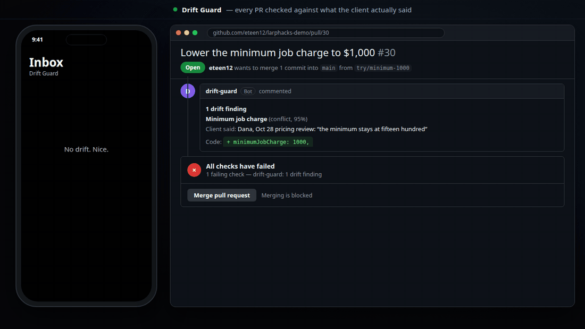
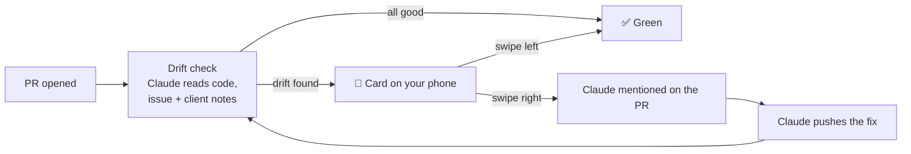

<div align="center">

# 🛡️ Drift Guard

### Your code passes the tests. It still might not be what the client asked for.

Every pull request, checked against what your client actually said.

<br>


<br>


<br><br>



</div>

---

## The problem

I run an agency. Clients tell us things on calls, it all goes into our Obsidian notes, and then a few weeks later:

- the **spec on GitHub** says one thing,
- the **code** says another,
- and the **client** changed their mind on a call nobody re-read.

Tests don't catch that. Code review doesn't catch that. AI agents writing the code *definitely* don't catch that.

**Drift Guard does.**

---

## How it works



| Step | What happens |
|---|---|
| **1. PR opens** | GitHub sends it to our backend. |
| **2. Claude checks it** | We clone the code, the linked issue (plus its parents and every comment), and the client's **Obsidian vault**. Claude Code runs read-only and searches the client's notes for every value and rule the PR touches. Newest note wins. |
| **3. Drift gets flagged** | The PR gets a comment with the receipts (*"Dana, Oct 28 pricing review: 12%"* vs `slowSeasonDiscountPercent: 10`) and a red `drift-guard` status. |
| **4. You swipe** | Every finding is a card on your phone. **Right** = it's drift, tell Claude what to change. **Left** = it's fine, the PR goes green and it won't be flagged again. |
| **5. Claude fixes it** | Swipe right reopens the issue, records the decision, and comments `@claude` on the PR. Claude pushes the fix and the check runs again. |

---

## 🗂️ Obsidian vault integration

All our client context lives in **Obsidian**: call notes, meeting transcripts, emails, decision logs. The vault is **synced to a GitHub repo** (Obsidian Git plugin), so it's always up to date with what the client last said.

On every PR, Drift Guard clones the vault next to the code and Claude **searches it for the client's details**:

```
vault/
└── clients/
    └── maple-ridge-painting/
        ├── profile.md
        ├── decisions.md            ← running log of what was agreed
        ├── meetings/2026-10-28-pricing-review.md
        ├── emails/2026-10-29-discount-confirmation.md
        └── transcripts/2026-10-28-pricing-review-transcript.md
```

- **Scoped to the right client.** Another client's "10% discount" never gets mixed in.
- **Newest wins.** If the client changed their mind, the latest note is the truth.
- **No index to maintain.** The vault is searched fresh on every PR, so there's nothing to go stale.

---

## 🎬 The demo

Our demo client is **Maple Ridge Painting** (made up).

- **Oct 14:** the owner says the slow-season discount is **10%**. That goes into the GitHub issue.
- **Oct 28:** on a pricing call she changes it to **12%**. That only goes into the notes.
- An agent builds 10% from the issue. **Every test passes.**

Drift Guard catches it in **~25 seconds**, the card hits the phone, one swipe, and Claude pushes the 12% fix. ✅

---

## 🤖 For agents too

Coding agents can use Drift Guard directly through our **MCP server**:

| Tool | What it does |
|---|---|
| `get_drift` | "Has my issue drifted from what the client said?" |
| `approve` | Send a finding to Claude to fix |
| `dismiss` | Mark a finding as fine |
| `record_decision` | Log a new decision on the issue |

---

## Stack

| Part | Tech |
|---|---|
| **Backend** | TypeScript · Node · Hono · Postgres · Docker on Render |
| **The check** | Claude Code headless (`claude -p`) on Haiku, read-only tools. ~25s and ~1–2¢ per check |
| **Client context** | Obsidian vault synced to GitHub |
| **The fix** | `anthropics/claude-code-action`, triggered by `@claude` on the PR |
| **App** | Expo / React Native on a phone (Expo Go) |
| **Agents** | MCP server over streamable HTTP |
| **Tests** | Vitest (250+ backend tests) · Jest · Playwright swipe-flow test on every PR |

## What's in here

```
backend/          Hono server: webhook, drift check, findings API, approve/dismiss, MCP
  src/check/      clone → GitHub context → Claude → validate → save → comment + status
  src/actions/    GitHub writes, approve/dismiss, findings store
  src/mcp/        MCP server
  check-prompt.md what Claude is told to do
shared/           the finding type everything agrees on
src/              the Expo app (swipe inbox)
e2e/              Playwright test of the full swipe flow
```

## Run it yourself

You'll need your own GitHub token, Claude token, a Postgres database, a repo to check and an Obsidian vault repo. Everything's listed in [`backend/.env.example`](backend/.env.example).

```bash
cd backend && npm install && npm run dev   # backend on :3000, reads backend/.env.local
npm install && npx expo start              # app, reads .env.local
```

---

<div align="center">

Built at **LARP Hacks** by [Ethan](https://github.com/eteen12) · [Eric](https://github.com/ChardXBT) · [David](https://github.com/ChikawaS04) · [Heng](https://github.com/Heng2007)

</div>
